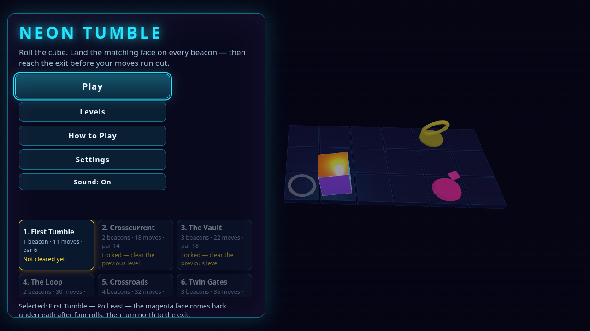
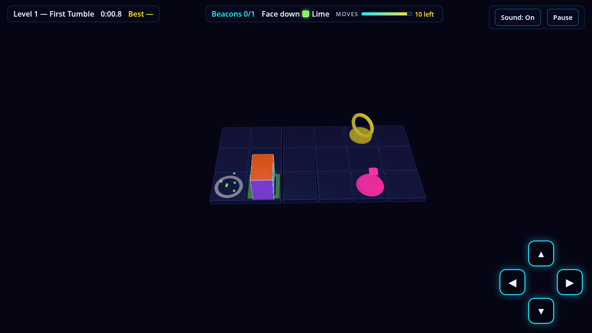

# Neon Tumble

A 3D neon cube-rolling puzzle. Roll a six-coloured cube across floating
platforms, land the matching face on every beacon to light it, then reach
the exit portal before your moves run out.

**Play it:** https://namdev-muse.github.io/neon-tumble/ *(goes live with the
first milestone push — v0.1.0 is currently a local M1 build)*




## How to play

- **Roll** the cube one cell at a time with the arrow keys / WASD, the
  on-screen D-pad, or a swipe. Every roll tips the cube — tracking which
  face ends up underneath is the skill.
- Each **beacon pad** has a colour. It lights only when the cube lands on
  it with the **matching face down**. The HUD always names the face
  currently down, and a wrong-face landing tells you exactly what the
  beacon needed.
- Light **every beacon**, then roll onto the **gold exit portal**. The
  portal stays locked until all beacons burn.
- Every roll costs a **move** from the level's budget — run out and the
  level fails. Walls block rolls (no move spent); rolling off the edge
  drops the cube.
- Score = clear bonus + unused-move efficiency + time bonus. Each clear
  earns a rank: **S** (in par moves), **A** (within par + 2), **B**
  (cleared). Best score and rank are saved per level; clearing a level
  unlocks the next.

There is no auto-roll, no next-move hint and no solution preview — the
cube's visible faces show its current state only.

## Levels (v0.1.0)

| # | Level | Beacons | Par | Budget |
|---|-------|---------|-----|--------|
| 1 | First Tumble | 1 (Magenta) | 6 | 11 |
| 2 | Crosscurrent | 2 (Lime, Gold) | 14 | 18 |
| 3 | The Vault | 3 (Orange, Violet, Magenta) | 18 | 22 |

Pars are the BFS solver's minimum move counts (position + orientation +
lit beacons), verified by the bot harness. More levels land in M2.

## Controls

- Arrow keys / WASD — roll · R — restart level · P — pause · M — mute
- Touch / mouse — D-pad buttons or swipe on the platform
- Esc closes panels, Enter confirms on menus

Playtest path (not in the player UI): `?level=N` jumps into a level,
`?unlock=1` unlocks all levels.

## Tech

- Three.js 0.160.0 via CDN import map (pinned), vanilla HTML/CSS/JS,
  no build step, static files on GitHub Pages.
- `physics.js` is a pure simulation core (orientation math, roll rules,
  BFS solver, scoring, save) with no DOM — `game.js` owns the renderer,
  menus, Web Audio synth SFX + generative music, and game feel
  (trauma shake, hit-stop, pooled particles).
- Accessibility: volume, shake strength, music/SFX toggles, reduce
  flashing, text size, high contrast, plus an FPS guard that steps the
  render scale down on slow devices.

## Tests

```sh
npm test              # smoke (sim) + bot (anti-slop gates)
npm run render-check  # headless browser: menu, rolls, autopilot clears
npm run screenshots   # size sweep 1280x720 / 2560x1080 / 1080x2340
npm run serve         # local server on :8942
```

The bot harness gates every level: the solver bot clears in exactly par
moves through the public roll hook; no-input, spam-one-direction and
random-roll bots (50 seeds/level) must fail — rolling at random is not
a strategy.

## License

MIT — see [LICENSE](LICENSE).
